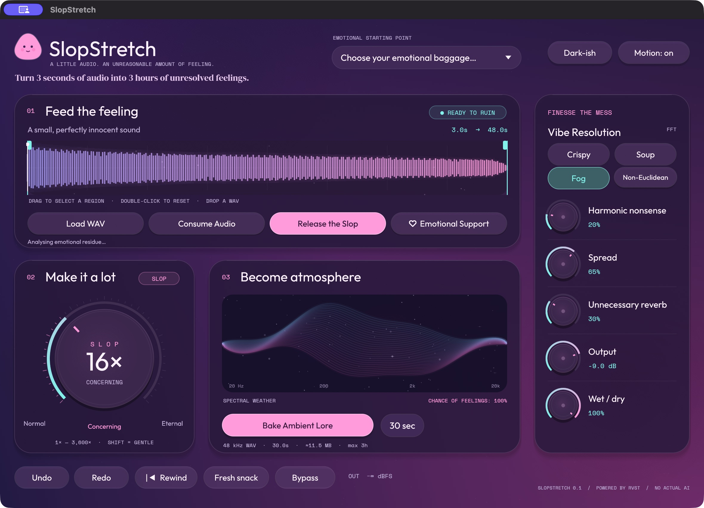
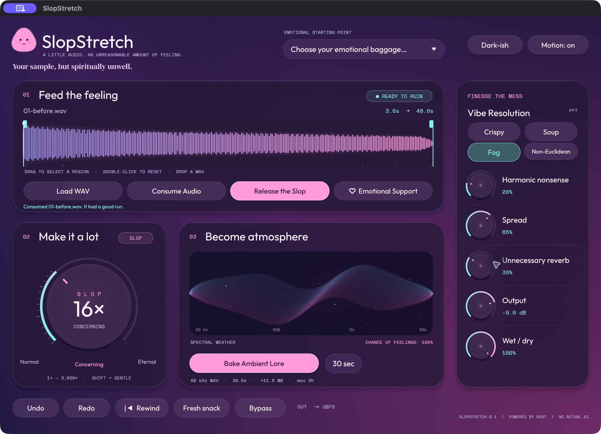

<h1>🫠 SlopStretch</h1>
<h3>A LITTLE AUDIO. AN UNREASONABLE AMOUNT OF FEELING.</h3>

Turn 3 seconds of audio into 3 hours of unresolved feelings.

VST3 · CLAP · Standalone 
<em>1–3,600× stretch · nine emotional starting points · absolutely enormous buttons</em>

*For producers who want ambience, but with consequences.*

Your kick drum has requested an indefinite leave of absence.

SlopStretch turns little sounds into enormous, slowly unfolding textures. Feed it
a vocal chop, a piano note, a door squeak, or the last three seconds of a recording
you insist is going somewhere. Stretch it into a pad. Freeze the good bit. Bake
the result into a WAV and put it underneath the pad underneath your other pad.

**Actual spectral time stretching. Completely unserious packaging.**

## 🥄 Your first serving of Slop

Open **SlopStretch.app** for a standalone session, or use the **VST3 / CLAP**
effect in a compatible host. The current packaged build is for Apple Silicon Mac.

There is already a three-second demo inside. Press **Release the Slop**.
Congratulations. The room now has a backstory.

1. **Feed the feeling.** Click **Load WAV**, or drop a WAV onto the window.
   In your DAW, **Consume Audio** records the audio arriving at the plugin;
   press it again to finish. Keep your source to **30 seconds or less**.
2. **Choose the emotionally available bit.** Drag across the waveform to select
   a region. Double-click it to return to the whole sample. The duration display
   shows how much time you are about to turn into wallpaper.
3. **Make it a lot.** Turn **SLOP** clockwise. Start around **16×** and listen.
   Keep going until the original sound would struggle to identify itself in a lineup.
4. **Become atmosphere.** Pick a texture, season with harmonics and spread, and
   choose a duration beside **Bake Ambient Lore**. Hit the button and choose a new filename. Receive WAV.
   Tell your collaborators you have been “working on the space.”

> **Standalone snack advisory:** load a WAV to use your own sound. **Consume Audio**
> captures incoming host audio; the standalone app does not open your microphone.

## 🎛️ The Department of Increasingly Questionable Knobs

| The thing you click | What it actually does | Official Slop Department assessment |
| --- | --- | --- |
| **SLOP** | Sets the stretch factor from **1× to 3,600×**. | Normal → Concerning → Eternal. Your session tempo has left the group chat. |
| **Release the Slop** | Starts or pauses playback. | Please stand behind the emotional splash guard. |
| **Emotional Support** | Holds the current spectral position. Press again to release it. | “It’s okay to stay here.” |
| **Vibe Resolution** | Changes the analysis window and resulting texture. Try **Crispy**, **Soup**, **Fog**, or **Non-Euclidean**. | A perfectly normal set of units. |
| **Harmonic nonsense** | Adds harmonic colour. | Give your sound a second, less employable personality. |
| **Spread** | Adjusts the stereo spread. | Your sample would like both armrests. |
| **Unnecessary reverb** | Adds reverberant ambience. | For the reverb underneath the reverb. |
| **Wet / dry** | Blends the stretched sound with incoming audio in a DAW. | A small hatch back to civilisation. |
| **Output** | Sets the output level. | Feelings may be enormous. Levels can remain sensible. |
| **Bake Ambient Lore** | Exports a stereo WAV in the background. | `final_final_v7.wav` deserves a creation myth. |

Hover over controls for plain-language help. **Undo**, **Redo**, and **Rewind**
are there for sudden outbreaks of taste. Hold **Shift** while adjusting a knob
for smaller changes. **Fresh snack** brings back the included demo.

*A small, perfectly innocent WAV, moments after being informed of the programme.*

## 🧳 Choose your emotional baggage

Nine presets. Nine very normal reasons to stare at a waveform without blinking.
They change the sound settings and keep your loaded sample.

| Preset | Suggested artistic emergency |
| --- | --- |
| **Cathedral But Sad** | The choir has gone home. The building is still processing it. |
| **Elevator to the Subconscious** | Floor −7: forgotten dreams, soft furnishings, one sustained F-sharp. |
| **Wet Carpet Ambient** | A boutique hotel corridor with something it needs to tell you. |
| **AI Thinks This Is Cinematic** | The trailer is for a film about opening a folder. |
| **Frozen Sainsbury’s Freezer Aisle** | An orchestral meditation on the last reduced lasagne. |
| **Podcast, But It Has Seen Things** | “Welcome back” has become a geological event. |
| **Kick Drum Having an Existential Crisis** | It used to mark the beat. Now it questions the passage of time. |
| **Ambient For People Who Own Too Many Reverbs** | You know who you are. We have reserved you a very large room. |
| **Vocal Chop, But It Ascended** | The syllable has acquired a robe and stopped replying to texts. |

### Three recipes. No culinary qualifications.

**The pad underneath the pad.** Load a short chord, choose **Cathedral But Sad**,
and try **Fog**. Select a region starting at the moment you like, then engage
**Emotional Support** and bake a short texture for your sampler. You are legally
allowed to stop turning knobs.

**Percussion with a complicated past.** Load one drum hit. Start with **Crispy**
and a modest stretch, then compare it with **Soup** and more SLOP. A kick can have
a tail. A kick can have a childhood. These are separate artistic decisions.

**The mysterious background human.** Load a vocal fragment, choose **Vocal Chop,
But It Ascended**, and audition a small region. Bring the output down and tuck
it behind your track. Nobody needs to know that the celestial choir said “yeah.”

## ✨ Features requested by absolutely nobody in procurement

- **Purple-to-pink everything.** Floating blobs, translucent panels, soft glows,
  and buttons with the physical confidence of expensive marshmallows.
- **Too many fonts.** One for the product. One for the feelings. One to make
  the numbers look like they passed a background check.
- **A spectral nebula.** The waveform gets more cosmic as the stretch increases;
  the nebula responds to your sonic misbehaviour.
- **A small supportive creature.** It follows the cursor. It believes in you.
  Its opinion has not been peer-reviewed.
- **Dark-ish mode.** It makes the gradients darker. We consider this personal growth.
- **Motion on/off.** Turn the movement down when you need to concentrate.
  The feelings remain full resolution.
- **A loader that stretches to 100% and becomes pixelated.** Artificial waits.
  Real commitment to the bit. You can skip it; the joke does not slow the audio engine.

> “The world’s first AI-native ambient slop engine.”
>
> — Our loader, which is not a reliable source.

There is **no AI service** involved. The audio processing runs locally.
The intelligence is artificial only in the marketing department.

## 🍮 Bake now. Explain later.

Choose **1 second to 3 hours** beside **Bake Ambient Lore**. The size estimate
helps you decide how much of your disk should become a feeling. Export runs in
the background and can be cancelled.

- **Input:** mono or stereo WAV, up to **30 seconds**, at **8–192 kHz**.
- **Output:** **48 kHz stereo, 32-bit float WAV**.
- **Filenames:** choose a new one for every bake. Existing files are preserved.
- **Starting point:** bakes start at the beginning of your selected region,
  including frozen bakes; they do not resume from the live playhead.
- **Dry export:** the dry side uses your selected source at its original speed.
  In a DAW, the live dry side is the incoming audio.

The three-hour setting is the export ceiling. **Eternal** is a mood, not a
contractual commitment to occupy your hard drive until the heat death of the universe.

## 🛟 Small practical things, wearing a large silly hat

**Why is it silent?** The app starts paused. Press **Release the Slop**. If you
have just captured silence, load a WAV or use **Fresh snack** to restore the demo.

**Why is the sound staying in one place?** **Emotional Support** is probably on.
Switch it off when both of you are ready to move on.

**Can I use this without a DAW?** Yes. Open the standalone app and load a WAV.
The browser version is a visual preview; it does not play or process audio.

**Does selecting a preset replace my sample?** No. Your sample keeps its job.
Its working conditions may change substantially.

**Is this a finished commercial release?** This is **v0.1.0**, a local Apple Silicon
Mac development build with ad-hoc signing. Native playback, WAV loading/export,
automated checks, and plugin validators have been exercised. It is not notarized
or qualified in a DAW yet, and a full three-hour render has not been tested.
Windows, Linux, Intel Mac, AU, and AAX builds are not supplied in this version.
[The unfunny details live here.](docs/verification.md)

**Keyboard snacks:** `Space` play/pause · `L` load · `C` capture · `F` freeze ·
`B` bake · `Home` rewind. Click inside the editor first; your DAW may reserve some keys.

---

**Stretch responsibly.** 
*Your sample, but spiritually unwell.*

Built with <a href="https://github.com/S33G/rvst">RVST</a> · <a href="https://github.com/S33G/rvst/tree/main/docs">Developer docs</a>. The emotional decisions are ours.

**Made with &lt;3 with AI**

