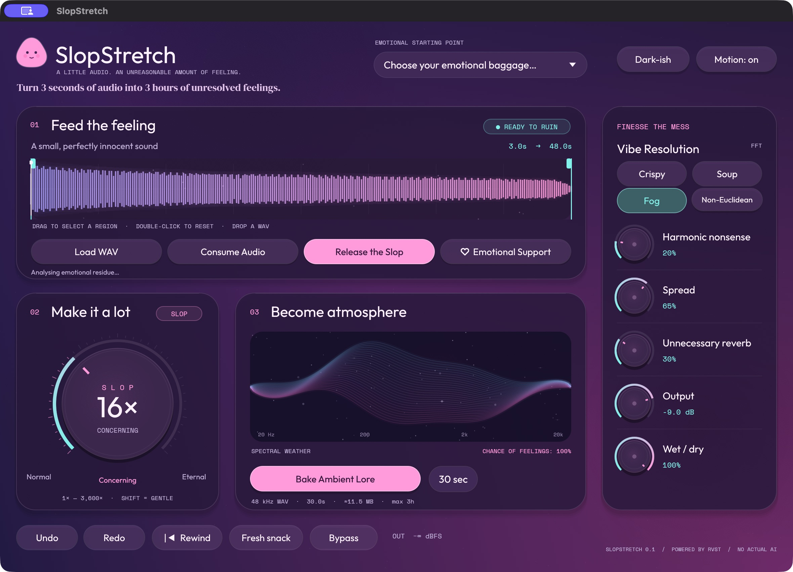

# SlopStretch verification — 31 October 2026

SlopStretch 0.1.0 was built and exercised locally on macOS Apple Silicon. The
development packages are `dist/SlopStretch.app`, `dist/SlopStretch.vst3`, and
`dist/SlopStretch.clap`. They have local ad-hoc signatures; they are not notarized
or qualified in a DAW.

| Evidence | Result | Record |
| --- | --- | --- |
| Workspace tests | 17 passed: 10 DSP/state/capture/export tests and 7 editor interaction/rendering tests; 0 failed | [Cargo test log](verification/tests.txt) |
| Formatting and lint | `cargo fmt --all --check` and workspace/all-target Clippy with `-D warnings` passed | Local final build pipeline |
| CLAP validator | 35 passed, 9 skipped, 0 failed against the packaged CLAP | [Structured results](verification/clap-validator.json), [validator output](verification/clap-validator-stderr.txt) |
| VST3 pluginval | SUCCESS at strictness 5, including editor creation, opening the editor while processing, editor automation, state, audio processing, and bus checks | [pluginval log](verification/pluginval.txt) |
| Offline audio examples | Completed 3-second original-speed, 24-second stretched, and 12-second frozen renders; all have measured nonzero output | [Render log](verification/audio.txt), [audio files](../dist/audio/) |
| Native standalone editor | Opened and visually inspected; playback and Emotional Support interactions exercised | [Final appearance](verification/native-final.png), [playing](verification/native-playing.png), [freeze](verification/native-freeze.png) |
| Native file dialogs | Loaded the generated WAV and exported a 30-second stereo float WAV through the app | [Loaded editor](verification/native-loaded.png), [export measurements](verification/native-export.json) |

The DSP tests check pitch preservation on a 440 Hz tone at 8× and 64× stretch,
source-clock advancement, exact original-speed playback, region selection,
freeze, capture resampling, and agreement between f32 and f64 processing. They
exercise host rates of 1 kHz, 44,100.5 Hz, 384 kHz, and 768 kHz in addition to the
ordinary 44.1/48 kHz cases. Those extremes verify bounded, finite processing and
source timing; they are not audio-quality measurements across every supported
rate. WAV import remains limited to 8–192 kHz files and 30 seconds of source.

Allocation instrumentation checks allocations, reallocations, and deallocations
on the tested callback thread, including the first FFT, resolution changes,
capture start/stop, source changes, rewind, and parameter events. State tests
cover embedded-source restoration and rejection of corrupt state before
mutation. Concurrent source publication tests check finite, bounded output.
These are bounded offline regressions, not a long-duration concurrency or CPU
deadline qualification.

Export tests cover WAV decoding, duration, selection, dry mixing, bypass, input
limits, preservation of existing files, and cancellation with partial-file
cleanup. Offline dry output is the selected source at original speed; native dry
output is the host input. The long-export path streams to disk and accepts up to
three hours at 48 kHz. A complete three-hour render has **not** been run. The
100-second cancellation test cancels early; it does not establish completion of
a 100-second or three-hour export.

Native file-dialog QA loaded `01-before.wav` and confirmed its filename and
waveform in the editor. **Bake Ambient Lore** then saved `native-bake.wav`
through the native save dialog. The resulting WAVE_FORMAT_EXTENSIBLE float32
file contains 1,440,000 stereo frames at 48 kHz: exactly 30 seconds and
11,520,068 bytes. All samples are finite, with peak 0.058218 and RMS 0.008094.
The native render is included in `dist/audio`.

The editor tests send real egui pointer and keyboard events through the shared
editor. They check loader skip and shortcut gating, transport and freeze,
initial preset selection, grouped host edits, knob limits and gesture pairing,
region dragging, reversed host region values, and host undo/redo routing. Every
test frame is tessellated and its mesh positions and UVs checked for finite
values. Loader stages, normal and frozen displays, and extreme visual settings
are covered at 1180×820, 980×798, and with no initial screen rectangle. These
regressions protect the fixed first-frame font and nebula NaN crashes. The
playing/freeze screenshots precede the final font and icon polish; the final
appearance screenshot below shows the packaged editor's updated presentation.



CLAP's nine skips are three preset-discovery checks, three note-input checks,
and three optional audio-port configuration/activation checks. The plugin does
not expose those capabilities. Its nine named sound presets are available in
the editor. Pluginval exercised 44.1, 48, and 96 kHz with block sizes 64–1024 and
32-frame automation sub-blocks. Its separate Steinberg VST3-validator stage was
skipped because no validator path was configured. The generic `auval` heading
in that VST3 log is not evidence of an AU build or AU validation.

No DAW session, DAW capture routing, host project save/reopen, extended playback
soak, or subjective listening qualification is claimed. Windows, Linux, Intel
macOS, AU, and AAX have not been built or qualified in this run. The browser
runner is an editor preview and does not process audio.

The packaged executable SHA-256 values at this verification point are:

```text
SlopStretch.app:  10e5b6b99dd119cd8cb879c5e8557897101de778609f4b0b79c13398307caff7
SlopStretch.vst3: 010a9c4f245799ac67b3420f576d84fdbfb204883de28a5d11a883d6adec880a
SlopStretch.clap: 010a9c4f245799ac67b3420f576d84fdbfb204883de28a5d11a883d6adec880a
```

The hashes identify each bundle's `Contents/MacOS/SlopStretch` executable.
Rebuilding or signing again can change them.
